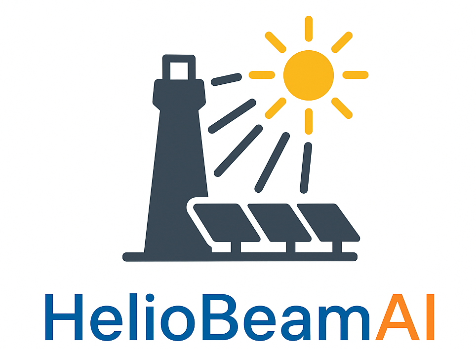

<p align="center">
  
</p>

[](https://doi.org/10.21203/rs.3.rs-6192986/v1)
[](https://opensource.org/licenses/MIT)
[](https://fair-software.eu)


# HelioBeamAI
Transformer-Based Receiver-Level Flux Prediction Using Calibration Target Images

## Overview

**HelioBeamAI** presents a scalable, data-driven solution for heliostat flux prediction in central receiver solar tower plants. Building upon previous work in beam characterization, this repository implements a Transformer-based encoder-decoder architecture capable of inferring spatially resolved focal spot distributions from standard calibration images. The approach eliminates the need for costly physical heliostat characterization by utilizing only calibration target data—making it highly scalable for large heliostat fields.

The pipeline consists of two core components:  
1. **A transformer-based encoder-decoder** model that generalizes focal spot predictions across aim points and sun positions.  
2. **A CNN-assisted projection module** to map predicted flux from the aperture plane onto arbitrary receiver surfaces.

This method achieves receiver-level prediction errors below 12%, outperforming deflectometry-enhanced ray tracing and enabling cost-effective integration in operational CSP plants. For a detailed explanation of the methodology, refer to the open-access publication:  
[Kuhl et al., 2025 – Preprint](https://www.researchsquare.com/article/rs-6192986/v1)

## Directory Structure

```
HelioBeamAI/
│
├── data/  # Directory for input data (real or synthetic)
│
├── HelioBeamAI/  # Main Python package directory
│   ├── model/  # Model definitions and training modules
│   │   └── vae/  # Variational Autoencoder-related code
├── scripts/  # Contains pipeline scripts
│   ├── 00_data_preparation/  # Scripts for preprocessing and organizing data
│   ├── 01_training/  # Scripts for training models
│   └── 02_inference/  # Scripts for making predictions using trained models
│
├── models/  # Trained model checkpoints or architecture files
│
└── tests/  # Unit or integration tests for the project

```

## Acknowledgments
This work is supported by the [Helmholtz AI](https://www.helmholtz.ai/) platform grant.

-----------
<div align="center">
  <a href="https://www.dlr.de/EN/Home/home_node.html"></a>
  <a href="https://www.fz-juelich.de/portal/EN/Home/home_node.html"></a>
  <a href="https://www.helmholtz.ai/"></a>
</div>